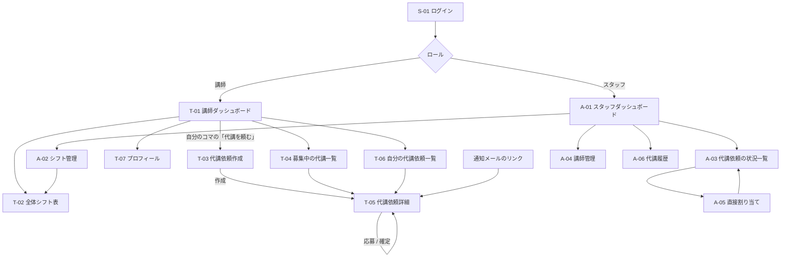
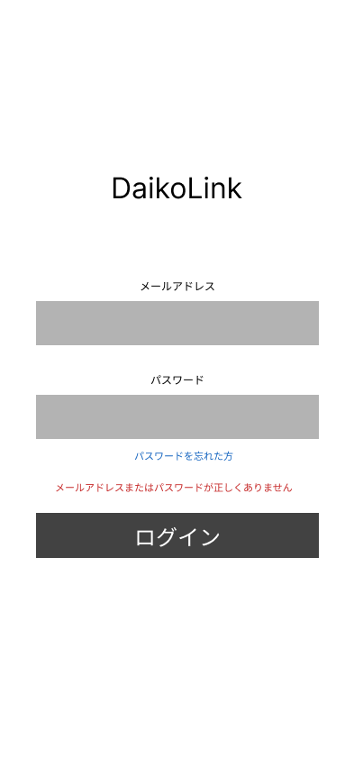
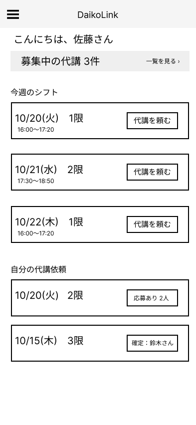
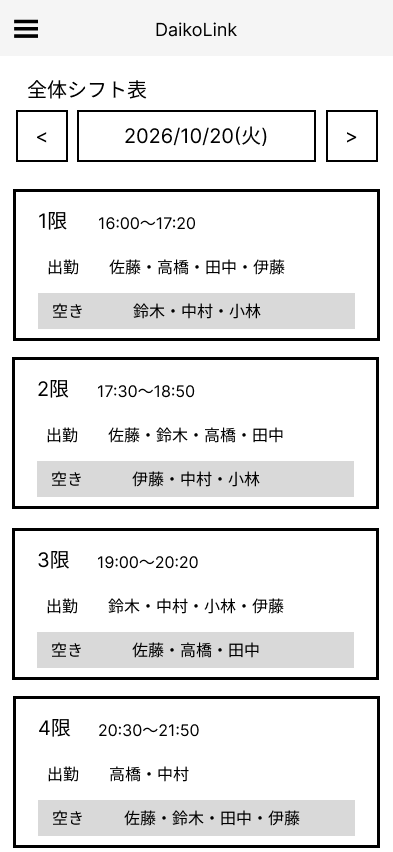
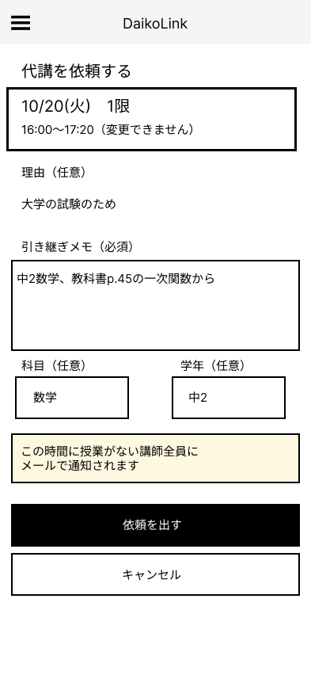
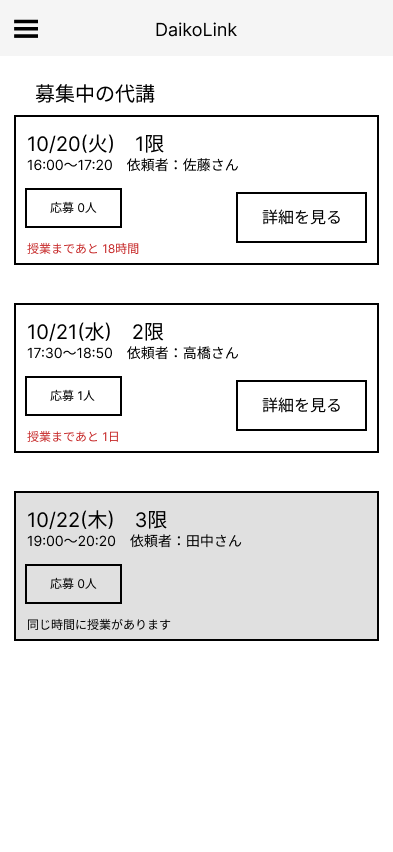
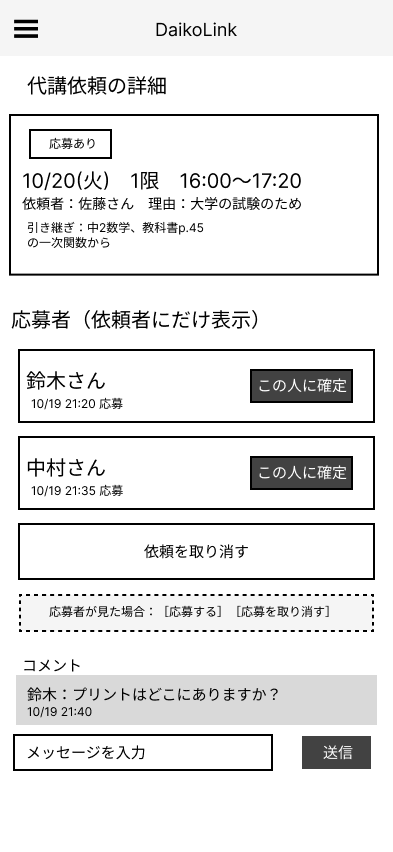
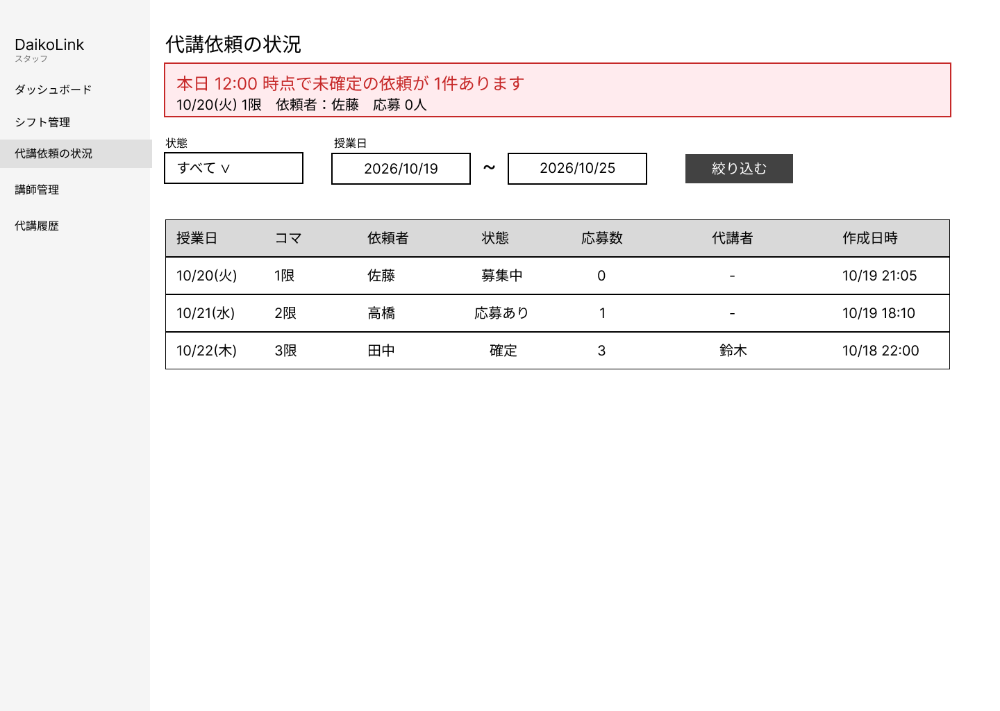

# 画面設計書

ワイヤーフレーム：Figma（`wireframes/` に書き出し画像を保存）
講師画面はスマートフォン（393 × 852）、スタッフ画面はPC（1440 × 1024）を基準とする。

## 画面一覧
| ID | 画面名 | ロール | 優先度 | Figma |
|---|---|---|---|---|
| S-01 | ログイン | 全員 | Must | ✓ |
| T-01 | 講師ダッシュボード（今週のマイシフト・自分の依頼状況） | 講師 | Must | ✓ |
| T-02 | 全体シフト表 | 全員 | Must | ✓ |
| T-03 | 代講依頼作成 | 講師 | Must | ✓ |
| T-04 | 募集中の代講一覧 | 講師 | Must | ✓ |
| T-05 | 代講依頼詳細（応募・確定・コメント） | 講師 | Must | ✓ |
| T-06 | 自分の代講依頼一覧 | 講師 | Must | |
| T-07 | プロフィール・担当科目 | 講師 | Should | |
| A-01 | スタッフダッシュボード | スタッフ | Must | |
| A-02 | シフト管理 | スタッフ | Must | |
| A-03 | 代講依頼の状況一覧 | スタッフ | Must | ✓ |
| A-04 | 講師管理 | スタッフ | Should | |
| A-05 | 代講者の直接割り当て | スタッフ | Could | |
| A-06 | 代講履歴 | スタッフ | Could | |

※ v1.1 の「マイシフト」は講師ダッシュボード（T-01）に統合した。

## 画面遷移図

## 各画面の構成（Figmaで作る画面）

### S-01 ログイン
- サービス名、メールアドレス・パスワード入力、ログインボタン、パスワードを忘れた方リンク
- エラー表示：入力欄の下に赤字（ログイン失敗・試行回数超過）
- 新規登録リンクは置かない（アカウントはスタッフが発行）

### T-01 講師ダッシュボード
- ヘッダー（サービス名・メニュー）
- 「募集中の代講 ○件」バナー → T-04
- 今週のマイシフト：日付ごとのカード（コマ名・時刻）、各カードに「代講を頼む」ボタン
- 代講で担当になったコマには「代講」バッジ
- 自分の依頼の状況：状態バッジ（募集中・応募あり・確定・取消・不成立）

### T-02 全体シフト表
- 日付切り替え（前日・翌日・カレンダー）
- 表：縦にコマ、各コマに出勤講師名の一覧
- 各コマに「このコマが空いている講師」を表示（代講を頼む相手が分かる）
- スマホでは表を横スクロール

### T-03 代講依頼作成
- 対象コマ（日付・コマ・時刻）を表示（変更不可）
- 理由（任意）、引き継ぎメモ（必須）、科目・学年（Should）
- 「依頼を出す」ボタン、注意書き「空いている講師全員にメールが届きます」
- エラー：授業開始済み・重複依頼のメッセージ

### T-04 募集中の代講一覧
- 依頼カード：日付・コマ・時刻・依頼者名・応募数・「授業まであと○時間」
- 自分が応募できない依頼（同時刻にシフトあり）はグレー表示
- 空状態：「現在募集中の代講はありません」

### T-05 代講依頼詳細
- 依頼内容（日時・依頼者・引き継ぎメモ）と状態バッジ
- 応募者として見た場合：「応募する」「応募を取り消す」ボタン
- 依頼者として見た場合：応募者リスト＋各応募者の「この人に確定」ボタン（確認ダイアログあり）、「依頼を取り消す」
- 確定後：代講者名を表示し、ボタンは非表示
- コメント欄（Should）

### A-03 代講依頼の状況一覧（PC）
- 状態・日付で絞り込み
- 表：日付・コマ・依頼者・状態・代講者・応募数・作成日時
- 当日分の未確定依頼を上部に赤で強調

## 設計チェックリスト
- [x] ユーザー導線：メールのリンクから1タップで T-05 に到達できる
- [x] エラー表示：フォーム・確定処理のエラーを各画面に設計
- [x] ローディング：応募・確定ボタンは押下後に無効化して二重送信を防ぐ
- [x] レスポンシブ：講師画面はスマホ基準、スタッフ画面はPC基準
- [x] アクセシビリティ：状態は色だけでなく文字のバッジでも表示

## ワイヤーフレーム（Figma）

### S-01 ログイン

### T-01 講師ダッシュボード

### T-02 全体シフト表

### T-03 代講依頼作成

### T-04 募集中の代講一覧

### T-05 代講依頼詳細

### A-03 代講依頼の状況一覧（PC）

