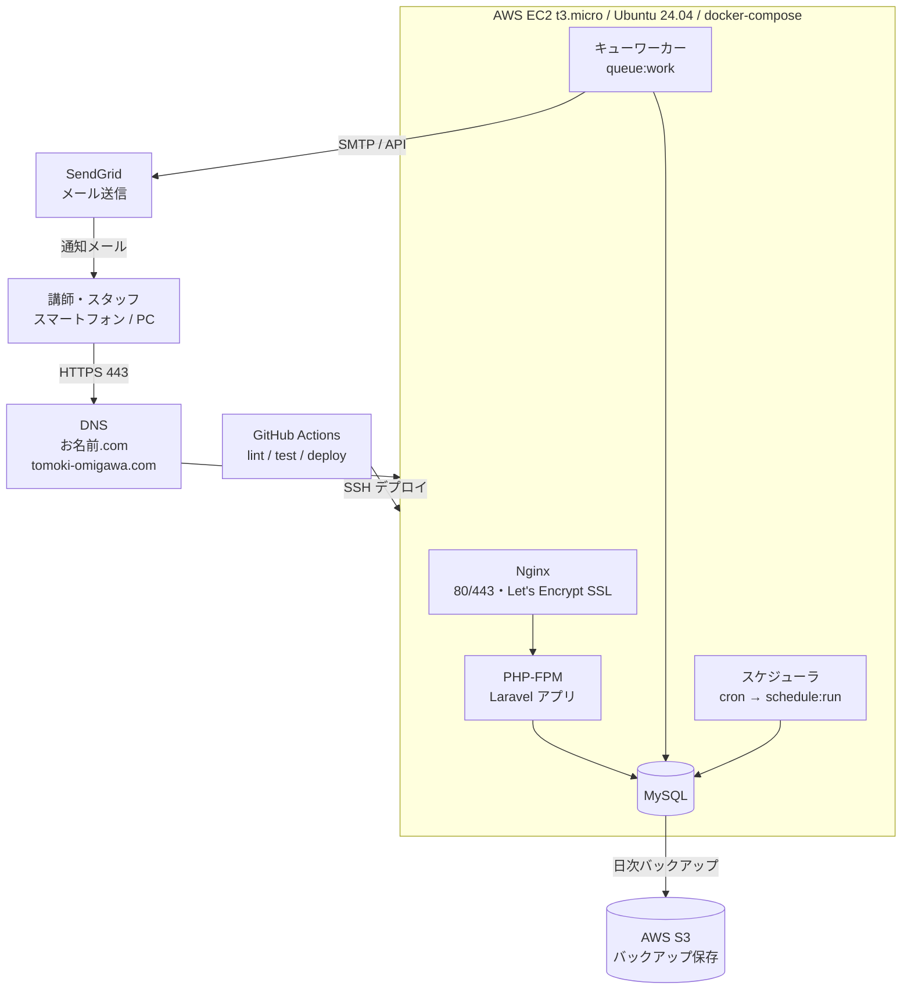

# インフラ構成図

## 構成図

## 構成要素
| 要素 | 使用するもの | 役割 |
|---|---|---|
| クライアント | スマートフォン（講師）、PC（スタッフ） | ブラウザから利用 |
| DNS | お名前.com（tomoki-omigawa.com） | 独自ドメインで公開（サブドメインで分けるかはデプロイ時に決定） |
| Webサーバー | Nginx（docker） | HTTPS 終端、PHP-FPM へのリバースプロキシ、静的ファイル配信 |
| アプリサーバー | PHP-FPM + Laravel（docker） | 画面と API の処理 |
| キューワーカー | `php artisan queue:work`（docker） | メールの非同期送信 |
| スケジューラ | cron で毎分 `php artisan schedule:run` | 不成立の自動更新（5分ごと）、正午の未確定通知 |
| データベース | MySQL（docker） | アプリのデータ、キュー（database ドライバ） |
| メール | SendGrid（無料枠） | 通知メール送信。SPF・DKIM を設定 |
| バックアップ | AWS S3 | DB の日次バックアップを保存 |
| CI/CD | GitHub Actions | lint・test・SSH 自動デプロイ（Week 15 の構成を流用） |

## Week 13〜17 の構成からの変更点
- キューワーカーとスケジューラのコンテナ（またはプロセス）を追加
- DB の日次バックアップを S3 に保存する仕組みを追加
- 画像アップロードがないため、CloudFront は使用しない
