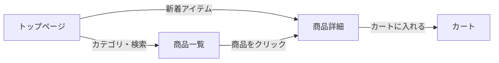
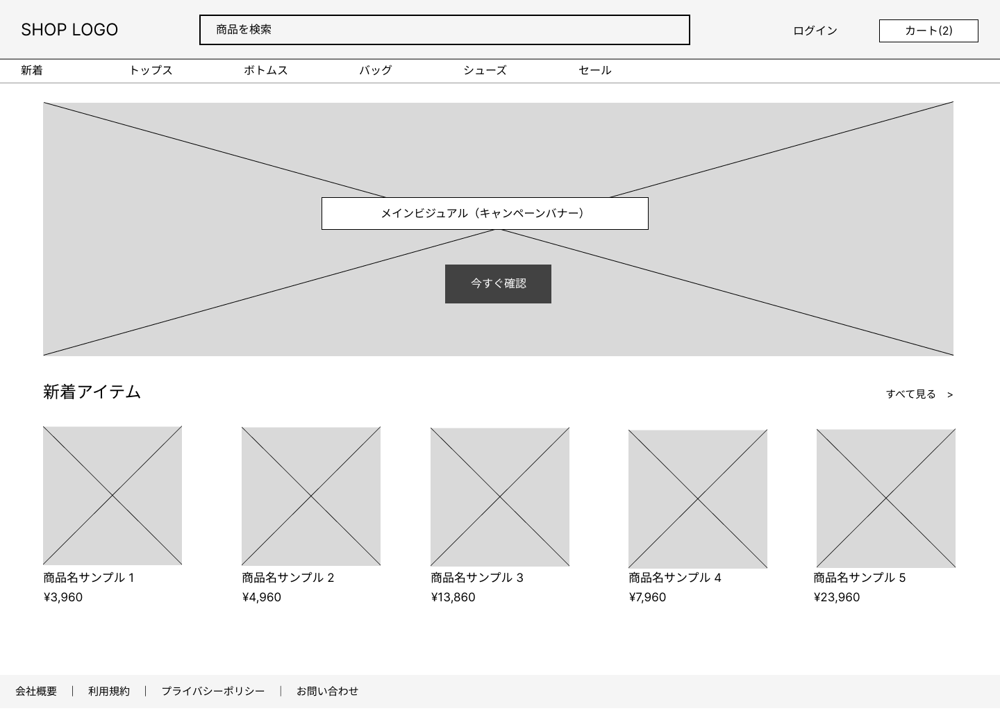
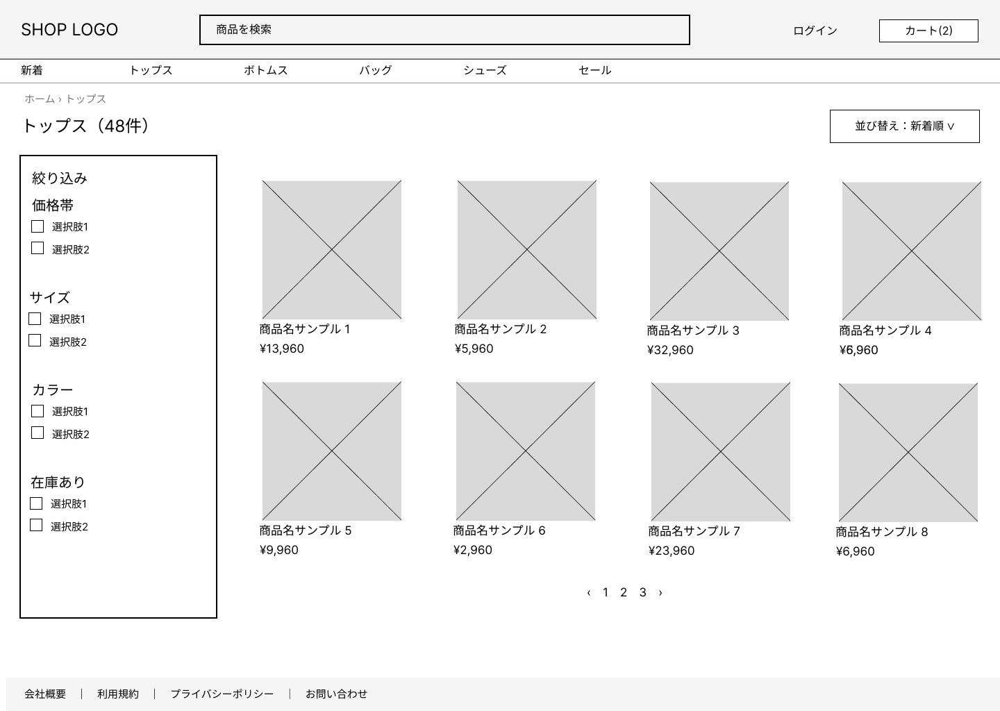
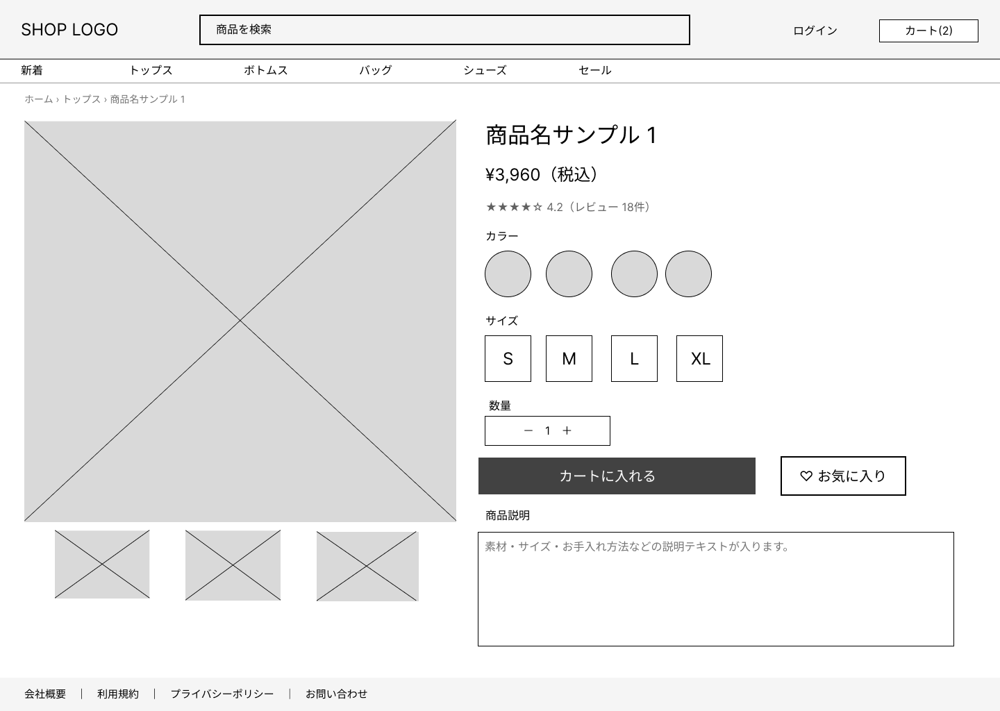

# 練習課題1：ECサイト 画面設計（Figma）

PC（1440 × 1024）を基準に、トップページ・商品一覧・商品詳細の3画面をワイヤーフレームで設計した。

| 画面 | 主な要素 |
|---|---|
| トップページ | ヘッダー（ロゴ・検索・ログイン・カート）、カテゴリナビ、メインビジュアル、新着アイテム、フッター |
| 商品一覧 | パンくず、件数、絞り込み（価格帯・サイズ・カラー・在庫）、並び替え、商品グリッド、ページ番号 |
| 商品詳細 | 商品画像とサムネイル、商品名・価格・レビュー、カラー・サイズ・数量、カートに入れる、お気に入り、商品説明 |

## 画面遷移

## トップページ

## 商品一覧

## 商品詳細

