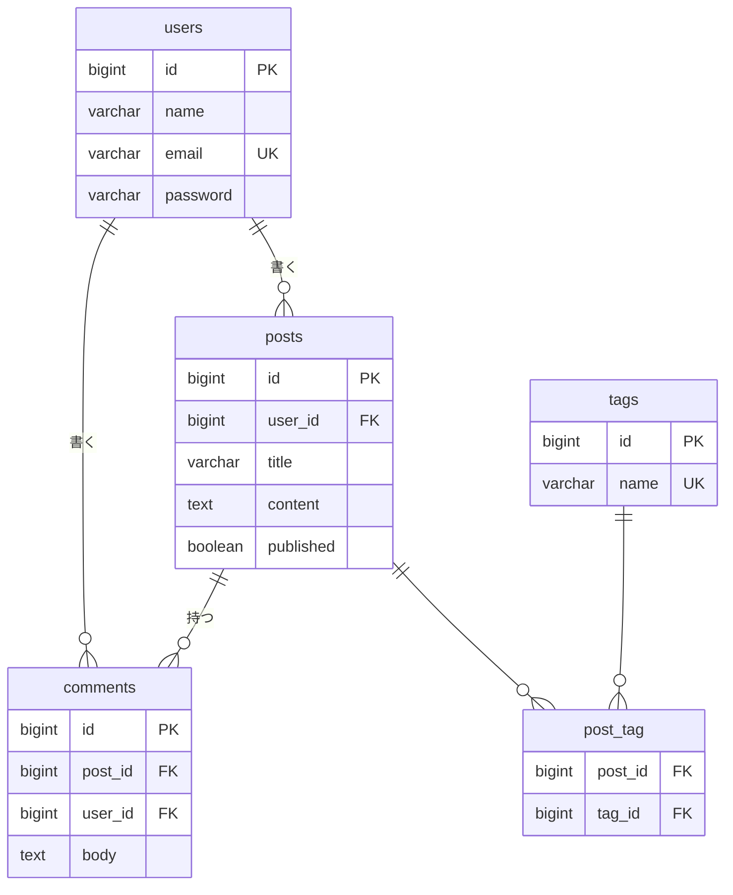

# 練習課題2：ブログシステム DB設計書

## ER図

## テーブル定義

### users（ユーザー）
| カラム名 | 型 | NULL | デフォルト | 説明 |
|---|---|---|---|---|
| id | BIGINT UNSIGNED | NO | AUTO_INCREMENT | ユーザーID（PK） |
| name | VARCHAR(50) | NO | - | ユーザー名 |
| email | VARCHAR(100) | NO | - | メールアドレス |
| password | VARCHAR(255) | NO | - | パスワード（ハッシュ） |
| created_at | TIMESTAMP | YES | NULL | 作成日時 |
| updated_at | TIMESTAMP | YES | NULL | 更新日時 |

- インデックス：PRIMARY KEY (id)、UNIQUE (email)
- 制約：password は8文字以上（アプリ側バリデーション）

### posts（投稿）
| カラム名 | 型 | NULL | デフォルト | 説明 |
|---|---|---|---|---|
| id | BIGINT UNSIGNED | NO | AUTO_INCREMENT | 投稿ID（PK） |
| user_id | BIGINT UNSIGNED | NO | - | 投稿者ID（FK） |
| title | VARCHAR(200) | NO | - | タイトル |
| content | TEXT | NO | - | 本文 |
| published | BOOLEAN | NO | false | 公開状態 |
| created_at | TIMESTAMP | YES | NULL | 作成日時 |
| updated_at | TIMESTAMP | YES | NULL | 更新日時 |

- インデックス：PRIMARY KEY (id)、INDEX (user_id)、INDEX (created_at)
- 外部キー：user_id → users(id) ON DELETE CASCADE

### comments（コメント）
| カラム名 | 型 | NULL | デフォルト | 説明 |
|---|---|---|---|---|
| id | BIGINT UNSIGNED | NO | AUTO_INCREMENT | コメントID（PK） |
| post_id | BIGINT UNSIGNED | NO | - | 投稿ID（FK） |
| user_id | BIGINT UNSIGNED | NO | - | コメント者ID（FK） |
| body | TEXT | NO | - | コメント本文 |
| created_at | TIMESTAMP | YES | NULL | 作成日時 |
| updated_at | TIMESTAMP | YES | NULL | 更新日時 |

- インデックス：PRIMARY KEY (id)、INDEX (post_id)、INDEX (user_id)
- 外部キー：post_id → posts(id) ON DELETE CASCADE、user_id → users(id) ON DELETE CASCADE

### tags（タグ）
| カラム名 | 型 | NULL | デフォルト | 説明 |
|---|---|---|---|---|
| id | BIGINT UNSIGNED | NO | AUTO_INCREMENT | タグID（PK） |
| name | VARCHAR(50) | NO | - | タグ名 |
| created_at | TIMESTAMP | YES | NULL | 作成日時 |
| updated_at | TIMESTAMP | YES | NULL | 更新日時 |

- インデックス：PRIMARY KEY (id)、UNIQUE (name)

### post_tag（投稿とタグの中間テーブル）
| カラム名 | 型 | NULL | デフォルト | 説明 |
|---|---|---|---|---|
| post_id | BIGINT UNSIGNED | NO | - | 投稿ID（FK） |
| tag_id | BIGINT UNSIGNED | NO | - | タグID（FK） |

- インデックス：PRIMARY KEY (post_id, tag_id)、INDEX (tag_id)
- 外部キー：post_id → posts(id) ON DELETE CASCADE、tag_id → tags(id) ON DELETE CASCADE

## 設計のポイント
- posts と tags は多対多のため、中間テーブル post_tag で正規化した
- 複合主キー (post_id, tag_id) で同じタグの重複付与を防ぐ
- 一覧の新着順表示を想定し posts.created_at にインデックスを張った
