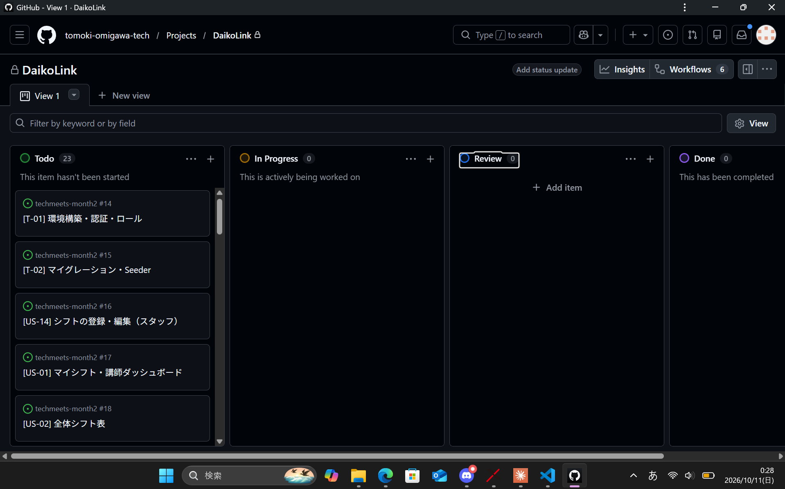

# カンバンボード（GitHub Projects）

ボード：[GitHub Projects「DaikoLink」](https://github.com/users/tomoki-omigawa-tech/projects/1)（このリポジトリの Issue を登録）

## なぜ GitHub Projects にしたか
- Issue・PR・コミットと紐づけられ、PR をマージすると自動で Done に移せる
- Week 22 以降の開発でそのまま使える（ツールを増やさない）

## 列の構成
| 列 | 意味 |
|---|---|
| Todo | 今のスプリントでやるタスク |
| In Progress | 作業中（WIP制限：2つまで） |
| Review | PR を作成し、CI とセルフレビュー待ち |
| Done | main にマージ済み（完了の定義を満たした） |

## Issue の付け方
| 項目 | 内容 |
|---|---|
| タイトル | `[US-03] 代講依頼の作成` のように ID を先頭に付ける |
| 本文 | ユーザーストーリーと受け入れ基準 |
| ラベル | `Must` / `Should`、`sprint-1` / `sprint-2` / `sprint-3`、`SP:6` など |
| マイルストーン | Sprint 1（Week 22） / Sprint 2（Week 23） / Sprint 3（Week 24） |

Issue は `01_user-stories.md` のバックログから作成した（Must 17件〔ユーザーストーリー12件＋技術タスク5件〕、Should 6件）。

## ボードのスクリーンショット

